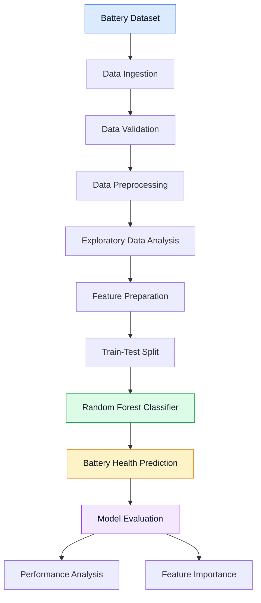
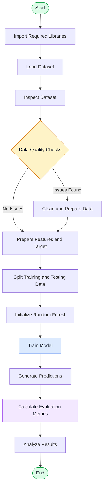
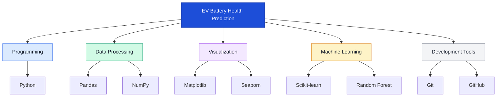
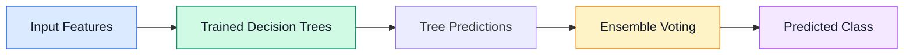

<div align="center">

# EV Battery Health Prediction

### Machine Learning for Intelligent Electric Vehicle Battery Analysis

Predicting battery health conditions through data-driven analysis and machine learning.

<br>


<br>

**[View Repository](https://github.com/AravindInish/EV-Battery-Health-Prediction-ML)**

</div>

---

## 1. Project Overview

Electric vehicles depend on battery systems for performance, reliability, and operational efficiency. Over time, battery characteristics can change due to usage patterns, charging cycles, temperature, and other operating conditions.

**EV Battery Health Prediction** is a machine learning project that explores battery-related data to identify patterns associated with battery health conditions.

The project uses a Python-based machine learning workflow involving data preprocessing, exploratory data analysis, feature preparation, model development, and performance evaluation.

The objective is to demonstrate how machine learning can support data-driven battery condition assessment and contribute to the development of intelligent electric vehicle monitoring systems.

### Project Information

| Attribute            | Description                                    |
| -------------------- | ---------------------------------------------- |
| Project Name         | EV Battery Health Prediction                   |
| Domain               | Electric Vehicles and Machine Learning         |
| Problem Type         | Classification                                 |
| Primary Algorithm    | Random Forest Classifier                       |
| Programming Language | Python                                         |
| Development Focus    | Data Analysis and Predictive Modeling          |
| Repository           | `AravindInish/EV-Battery-Health-Prediction-ML` |

---

## 2. Problem Statement

Battery health assessment is an important aspect of electric vehicle lifecycle management.

Traditional battery diagnostics may require specialized equipment, measurements, and established diagnostic procedures. Machine learning provides an additional approach for analyzing historical battery data and identifying patterns that may be associated with different battery conditions.

This project explores the following problem:

> How can machine learning techniques analyze battery-related data and classify battery health conditions using patterns learned from historical observations?

The model's predictions depend on the quality of the dataset, the features available, the target labels, and the validation methodology.

---

## 3. Project Objectives

* Analyze battery-related datasets to understand their characteristics.
* Perform exploratory data analysis to identify useful patterns.
* Prepare data for machine learning.
* Develop a Random Forest classification model.
* Evaluate predictive performance using appropriate classification metrics.
* Examine feature importance to understand model behavior.
* Establish a foundation for future EV battery analytics applications.

---

## 4. System Architecture

The following diagram illustrates the proposed high-level architecture of the project.



### Architecture Components

| Component            | Responsibility                                                |
| -------------------- | ------------------------------------------------------------- |
| Data Ingestion       | Load the battery dataset into the Python environment          |
| Data Validation      | Inspect columns, data types, missing values, and data quality |
| Data Preprocessing   | Prepare the data for analysis and modeling                    |
| Exploratory Analysis | Investigate distributions, relationships, and patterns        |
| Feature Preparation  | Select and transform model input features                     |
| Model Training       | Train the Random Forest classifier                            |
| Prediction           | Generate battery health classifications                       |
| Evaluation           | Measure predictive performance                                |
| Feature Analysis     | Examine the relative importance of model features             |

*This architecture represents the intended workflow. Individual stages should be verified against the implementation in the repository.*

---

## 5. End-to-End Machine Learning Workflow



### Workflow Explanation

**Phase 1 — Data Understanding**

Load the dataset and inspect its structure, feature types, missing values, and target variable.

**Phase 2 — Data Preparation**

Clean the data where necessary, identify suitable features, prepare the target labels, and create training and testing subsets.

**Phase 3 — Model Development**

Train the Random Forest classifier on the training data to learn patterns associated with the target battery health categories.

**Phase 4 — Model Evaluation**

Generate predictions on held-out data and evaluate the model using suitable classification metrics.

**Phase 5 — Result Interpretation**

Review classification results and feature importance to understand the model's predictive behavior and potential limitations.

---

## 6. Technology Stack

The project uses Python's data science and machine learning ecosystem.



### Technologies and Their Roles

| Technology    | Application                                 |
| ------------- | ------------------------------------------- |
| Python        | Core programming and model development      |
| Pandas        | Dataset loading, manipulation, and analysis |
| NumPy         | Numerical operations and array processing   |
| Matplotlib    | Data visualization                          |
| Seaborn       | Statistical charts and correlation heatmaps |
| Scikit-learn  | Model training, prediction, and evaluation  |
| Random Forest | Ensemble-based classification               |
| Git           | Version control                             |
| GitHub        | Source code hosting and collaboration       |

---

## 7. Machine Learning Model

### Random Forest Classifier

Random Forest is an ensemble learning algorithm that combines predictions from multiple decision trees to produce a classification result.

Each tree learns patterns from the training data, and the ensemble combines their outputs to generate the final prediction.

### Why Random Forest?

* Can model nonlinear relationships between features.
* Can capture interactions among input variables.
* Supports multiclass classification when the target contains multiple classes.
* Provides feature-importance estimates.
* Offers a practical baseline for structured tabular datasets.

The algorithm is a modeling choice, not a guarantee of high accuracy. Its effectiveness must be established through proper validation and comparison with suitable alternatives.

### Model Pipeline



*The diagram illustrates the general Random Forest classification process.*

---

## 8. Exploratory Data Analysis

Exploratory Data Analysis (EDA) helps identify patterns, understand the distribution of variables, and assess data quality before model development.

The repository includes visualizations intended to support this analysis.

| Visualization       | Analytical Purpose                               |
| ------------------- | ------------------------------------------------ |
| Histograms          | Examine feature distributions                    |
| Box Plots           | Identify potential outliers and variability      |
| Correlation Heatmap | Explore correlations among numerical variables   |
| Scatter Plots       | Examine relationships between pairs of variables |

### Visualization Assets

If the following files exist in the repository root, they can be displayed directly in GitHub.

#### Feature Distributions


#### Correlation Analysis


#### Outlier and Variability Analysis


#### Feature Relationship Analysis


These visualizations are exploratory tools. Correlation alone does not establish causation or prove that a feature is useful for prediction.

---

## 9. Model Evaluation Framework

Model evaluation is necessary to determine whether the classifier generalizes beyond the data used for training.

The following metrics can be used to assess classification performance.

| Metric           | Interpretation                                          |
| ---------------- | ------------------------------------------------------- |
| Accuracy         | Fraction of predictions that are correct                |
| Precision        | Fraction of predicted class instances that are correct  |
| Recall           | Fraction of actual class instances correctly identified |
| F1-Score         | Harmonic mean of precision and recall                   |
| Confusion Matrix | Distribution of correct and incorrect class predictions |

For multiclass classification, precision, recall, and F1-score can be calculated using macro, micro, or weighted averaging, depending on the evaluation objective.

### Results Reporting

Actual model results should be recorded here after executing the training and evaluation pipeline.

| Evaluation Metric | Result              |
| ----------------- | ------------------- |
| Accuracy          | Pending measurement |
| Precision         | Pending measurement |
| Recall            | Pending measurement |
| F1-Score          | Pending measurement |

**Important:** No numerical performance claims are made here because verified model evaluation results have not been supplied.

A confusion matrix and class-wise classification report should also be included when available.

---

## 10. Repository Structure

```text
EV-Battery-Health-Prediction-ML/
│
├── main.py
├── battery_dataset.csv
├── requirements.txt
├── README.md
│
├── aiml_sbmp_boxplots.png
├── aiml_sbmp_heatmap.png
├── aiml_sbmp_histograms.png
└── aiml_sbmp_scatterplot.png
```

| File                        | Description                       |
| --------------------------- | --------------------------------- |
| `main.py`                   | Main Python implementation        |
| `battery_dataset.csv`       | Battery dataset used for analysis |
| `requirements.txt`          | Project dependencies              |
| `README.md`                 | Project documentation             |
| `aiml_sbmp_boxplots.png`    | Box plot visualization            |
| `aiml_sbmp_heatmap.png`     | Correlation heatmap               |
| `aiml_sbmp_histograms.png`  | Histogram visualizations          |
| `aiml_sbmp_scatterplot.png` | Scatter plot visualizations       |

*The filenames above should match the actual files committed to the repository.*

---

## 11. Installation and Execution

### Prerequisites

* Python installed on your system.
* Git installed on your system.
* Required project dependencies.
* Access to the project dataset.

### Step 1 — Clone the Repository

```bash
git clone https://github.com/AravindInish/EV-Battery-Health-Prediction-ML.git
```

### Step 2 — Navigate to the Project

```bash
cd EV-Battery-Health-Prediction-ML
```

### Step 3 — Create a Virtual Environment

```bash
python -m venv venv
```

Activate it on Windows:

```bash
venv\Scripts\activate
```

Activate it on Linux or macOS:

```bash
source venv/bin/activate
```

### Step 4 — Install Dependencies

```bash
pip install -r requirements.txt
```

If the dependency file is not available, install the libraries required by the implementation:

```bash
pip install pandas numpy matplotlib seaborn scikit-learn
```

### Step 5 — Execute the Project

```bash
python main.py
```

The exact execution process depends on the implementation and its configured input and output paths.

---

## 12. Potential Real-World Applications

The techniques explored in this project may contribute to the development of:

* Electric vehicle battery condition analysis.
* Battery maintenance planning.
* Battery lifecycle monitoring.
* Electric vehicle fleet analytics.
* Battery replacement decision-support systems.
* Predictive maintenance research.
* Intelligent battery management applications.

This project demonstrates an experimental machine learning approach. It is not a certified battery diagnostic system and should not be used as the sole basis for safety-critical decisions.

---

## 13. Future Enhancements

Potential directions for further development include:

* State of Health (SOH) estimation using regression.
* Remaining Useful Life (RUL) prediction.
* Comparison of Random Forest with gradient boosting and other models.
* Hyperparameter tuning and cross-validation.
* Time-series battery degradation analysis.
* Explainable AI using SHAP.
* Interactive visualization with Streamlit.
* Model deployment through a REST API.
* Evaluation on independent battery datasets.
* Integration of real-world battery telemetry.

These enhancements would require suitable datasets, additional implementation, and validation.

---

## 14. Skills Demonstrated

* Python Programming
* Data Analysis and Preprocessing
* Exploratory Data Analysis
* Statistical Visualization
* Machine Learning Classification
* Random Forest
* Model Evaluation
* Feature Importance Analysis
* Version Control with Git
* Technical Documentation

---

## 15. Author

**Aravind Inish**

AI & Data Science Student | Machine Learning Enthusiast

GitHub: [@AravindInish](https://github.com/AravindInish)

Project: [EV Battery Health Prediction](https://github.com/AravindInish/EV-Battery-Health-Prediction-ML)

---

## 16. License

No license is specified in this documentation. Review the repository's existing license before redistributing the project or its contents.

---

<div align="center">

### Advancing Electric Mobility Through Machine Learning

If you find this project useful, consider starring the repository.

**Built with Python and Machine Learning.**

</div>
